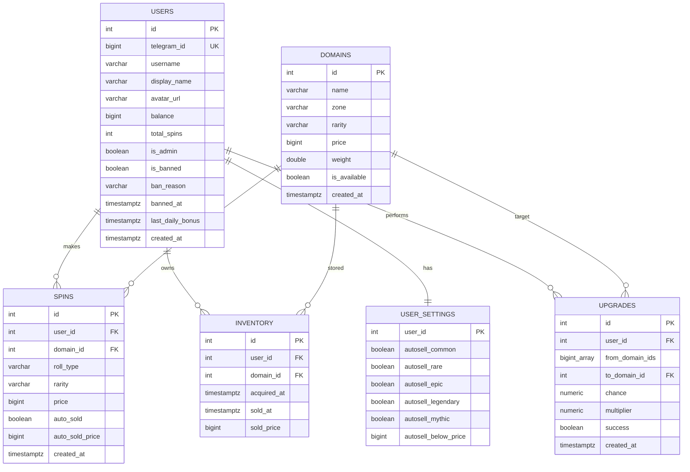

# Domain Drop

**Telegram Mini App — рулетка реальных доменных имён как игровых карточек.**
100 500 реальных зарегистрированных доменных имён, четыре зоны, игровые цены, четыре рулетки, автопродажа, массовая продажа, визуальный апгрейдер с круговой шкалой шанса и вкладка заработка.

> Доменные имена взяты из публичного рейтинга реальных доменов, но используются только как игровые карточки. Приложение не продаёт, не регистрирует и не передаёт права на домены, не принимает платежи, не использует реальные деньги и не поддерживает ставки.


## Содержание

- [Быстрый старт](#быстрый-старт)
- [GitHub Codespaces](#github-codespaces)
- [Каталог доменов](#каталог-доменов)
- [Рулетки](#рулетки)
- [Экономика и EV](#экономика-и-ev)
- [Автопродажа](#автопродажа)
- [Заработок](#заработок)
- [Уровни и удача](#уровни-и-удача)
- [Админка](#админка)
- [Массовая продажа](#массовая-продажа)
- [Апгрейдер](#апгрейдер)
- [Палитра и интерфейс](#палитра-и-интерфейс)
- [Архитектура](#архитектура)
- [API](#api)
- [База данных](#база-данных)
- [Тесты](#тесты)
- [Переменные окружения](#переменные-окружения)
- [Production checklist](#production-checklist)
- [Источники данных](#источники-данных)

---

## Быстрый старт

Нужен Docker Compose v2.

```bash
git clone https://github.com/kovpasio/domaindrop.git
cd domaindrop
docker compose up --build
```

При старте backend пересобирает **100 500 доменов** и обновляет цены/веса в PostgreSQL. На обычном ноутбуке это занимает 10–30 секунд; в это время API ещё не принимает запросы, но старые записи инвентаря сохраняются.

| Что | URL |
|---|---|
| Mini App | http://localhost:3000 |
| API | http://localhost:8000/api |
| Swagger | http://localhost:8000/api/docs |
| Health | http://localhost:8000/api/health |

Для браузера `DEV_MODE=true` включает demo-вход без Telegram. Внутри Telegram вход идёт через подписанный `initData`.

Остановка:

```bash
docker compose down          # сохранить базу
docker compose down -v       # удалить и пересоздать базу
docker compose up -d --build # пересобрать и запустить в фоне
```

### Telegram

1. Создайте бота у [@BotFather](https://t.me/BotFather).
2. Mini App должен открываться по публичному HTTPS.
3. Заполните `.env`:

```dotenv
BOT_TOKEN=123456789:AA...
WEBAPP_URL=https://ваш-публичный-https-адрес
DEV_MODE=false
ENVIRONMENT=production
JWT_SECRET=<случайная-строка>
```

4. Перезапустите:

```bash
docker compose up -d --force-recreate
```

5. Отправьте боту `/start` и нажмите **«Открыть Domain Drop»**.

`WEBAPP_URL` — это адрес **самого Mini App**, а не API. Без HTTPS Telegram не откроет приложение.

---

## GitHub Codespaces

В репозитории есть `.devcontainer/devcontainer.json` с Docker-in-Docker и проброшенными портами.

1. Загрузите проект в приватный GitHub-репозиторий.
2. **Code → Codespaces → Create codespace on main**.
3. В терминале:

```bash
cp .env.example .env
# Codespaces открывает порт через forwarding, поэтому разрешаем bind на 0.0.0.0
sed -i 's/^BIND_HOST=.*/BIND_HOST=0.0.0.0/' .env
docker compose up -d --build
```

4. В панели **Ports** сделайте порт **3000** публичным:

```text
Port Visibility → Public
```

5. Получите адрес вида:

```text
https://ваш-codespace-3000.app.github.dev
```

6. Пропишите его в `.env` как `WEBAPP_URL`, добавьте `BOT_TOKEN`, поставьте `DEV_MODE=false`.
7. Перезапустите:

```bash
docker compose up -d --force-recreate
```

Codespaces подходит для теста, но не для постоянного хостинга: при простое среда останавливается, а удаление Codespace удаляет Docker volumes.

---

## Каталог доменов

При каждом старте создаётся и обновляется **100 500 реальных зарегистрированных доменов** в зонах `.ru`, `.com`, `.io`, `.xyz`.

Имена берутся из статического снимка публичного рейтинга **Majestic Million**:

- `backend/app/data/real_domains.txt` — 100 500 имён;
- `backend/app/data/REAL_DOMAINS_SOURCE.md` — источник и ограничения;
- фильтр: только `.com`, `.ru`, `.io`, `.xyz`, без поддоменов и мусорных символов.

Это **игровые карточки**, а не продажа доменов. Права на имена не передаются, цены и редкость — вымышленные игровые значения.

Реальные имена детерминированно раскладываются по редкостям и получают непрерывную геометрическую ценовую сетку: Common `40–99 D`, Rare `100–999 D`, Epic `1 000–4 999 D`, Legendary `5 000–24 999 D`, Mythic `25 000+ D`. Для цен от 100 D соседние домены одной редкости отличаются не больше чем на **1%**; у Common минимальный шаг — 1 D. Границы соседних редкостей отличаются на 1 D.

### Диапазоны цен

| Редкость | Диапазон цены |
|---|---:|
| Common | 40–99 D |
| Rare | 100–999 D |
| Epic | 1 000–4 999 D |
| Legendary | 5 000–24 999 D |
| Mythic | 25 000–150 000+ D |

Значения разыгрываются детерминированно для каждого реального имени. Common больше не начинается с 1 монеты, а верхние тиры получили компактные диапазоны.

Популярные реальные домены закреплены с высокими игровыми ценами:

| Домен | Цена | Редкость |
|---|---:|---|
| `cars.com` | 100 000 000 | Mythic |
| `google.com` | 10 000 000 | Mythic |
| `youtube.com` | 8 000 000 | Mythic |
| `facebook.com` | 7 000 000 | Mythic |
| `amazon.com` | 6 000 000 | Mythic |
| `instagram.com` | 5 500 000 | Mythic |
| `twitter.com` | 5 000 000 | Mythic |
| `microsoft.com` | 4 500 000 | Mythic |
| `apple.com` | 4 200 000 | Mythic |

Всего закреплено 24 популярных имени, включая `tiktok.com`, `netflix.com`, `reddit.com`, `chatgpt.com`, `openai.com`, `github.com` и другие. `cars.com` — самый дорогой домен каталога.

### Редкость

| Цена | Редкость |
|---:|---|
| `< 100` | Common |
| `100–999` | Rare |
| `1 000–4 999` | Epic |
| `5 000–24 999` | Legendary |
| `25 000+` | Mythic |

### Шансы по рулеткам

| Рулетка | Common | Rare | Epic | Legendary | Mythic |
|---|---:|---:|---:|---:|---:|
| Обычная | 88.74% | 10.00% | 1.00% | 0.25% | 0.01% |
| Редкая+ | — | 93.00% | 5.00% | 1.80% | 0.20% |
| Эпическая+ | — | — | 90.00% | 8.00% | 2.00% |
| Легендарная+ | — | — | — | 90.00% | 10.00% |

Сначала по этой таблице выбирается редкость, затем равномерно случайный реальный домен внутри неё. Базовый RTP — 126–161% с ускорением на верхних тирах; удача дополнительно сдвигает шансы в сторону Rare+.

Примерное распределение сгенерированного каталога:

| Редкость | Количество |
|---|---:|
| Common | 30 000 |
| Rare | 25 000 |
| Epic | 18 000 |
| Legendary | 15 000 |
| Mythic | 12 500 |

---

## Рулетки

| Тип | Пул | Стоимость |
|---|---|---:|
| Обычная | все редкости | 100 D |
| Редкая+ | Rare, Epic, Legendary, Mythic | 700 D |
| Эпическая+ | Epic, Legendary, Mythic | 3 500 D |
| Легендарная+ | Legendary, Mythic | 15 000 D |

### ×3 прокрутка

На экране рулетки есть переключатель **×3**:

- выключен — обычный спин;
- включён — стоимость умножается на 3, выполняется три розыгрыша, а в результат попадает **лучший из трёх доменов**;
- счётчик круток увеличивается на 3;
- в инвентарь попадает один лучший домен.

Сервер сначала разыгрывает редкость по таблице шансов, затем берёт равномерно случайный доступный домен этой редкости.

Отдельная «Мифическая» рулетка удалена: при гарантированном Mythic-домене её EV нельзя сбалансировать без изменения цены спина. Mythic-домены остались в пулах «Редкая+», «Эпическая+» и «Легендарная+».

Стоимость списывается сразу при нажатии «Крутить». При выпадении Mythic-домена поверх экрана запускается отдельная анимация: пульсирующие кольца, частицы и крупная плашка с именем и ценой домена. Та же анимация показывается при успешном Mythic-апгрейде.

В карточке результата есть быстрые действия:

- **«Продать за N D»** — сразу продать выпавший домен;
- **«Оставить»** — если домен уже был автоматически продан, отменить автоселл: монеты списываются обратно, домен возвращается в инвентарь. Если монеты уже потрачены, вернуть домен нельзя.


---

## Экономика и EV

### Одна честная цена

У домена ровно одна цена — `domains.price`. При продаже на баланс зачисляется **вся указанная сумма**, без скрытого курса, комиссии или пересчёта.

Стартовый баланс нового игрока — **2 000 D**. Ежедневный бонус — **25% текущего баланса**, но не больше **1 000 000 D**.

Экономика построена на трёх опорах:

1. **Плотная ценовая лестница** — без больших разрывов между соседними доменами.
2. **Стоимости рулеток** — 100 / 700 / 3 500 / 15 000 D.
3. **Уровни удачи** — сдвигают шансы в сторону Rare+, но не меняют сумму вероятностей.

### EV рулеток

Расчёт по сгенерированному пулу и таблице шансов:

| Рулетка | Стоимость | EV | RTP | House edge |
|---|---:|---:|---:|---:|
| Обычная | 100 | **161.20** | 161.2% | −61.2% |
| Редкая+ | 700 | **879.90** | 125.7% | −25.7% |
| Эпическая+ | 3 500 | **4 918.20** | 140.5% | −40.5% |
| Легендарная+ | 15 000 | **19 621.40** | 130.8% | −30.8% |

Кривая сделана с ускорением: обычные и редкие спины дают умеренный рост, а Epic+ и Legendary+ — заметно больше. Со стартовых 2 000 D достаточно нескольких удачных Epic-спинов, чтобы дойти до легендарной прокрутки; при хорошем дропе это происходит быстрее.

### Апгрейдер

| Сектор | Цель | Множитель | EV по цене |
|---:|---:|---:|---:|
| 10% | ставка × 10 | ×10 | 1.00 |
| 25% | ставка × 4 | ×4 | 1.00 |
| 50% | ставка × 2 | ×2 | 1.00 |
| 75% | ставка × 4/3 | ×1.333… | 1.00 |

Точный шанс генерируется сервером внутри сектора: например, 50% → 50.00…50.99%. Цель считается как `ставка × 100 / точный шанс`:

```text
ставка = 106 900 D
шанс = 50.36%
цель = 106 900 × 100 / 50.36 ≈ 212 271 D
```

Сервер выбирает ближайший реальный домен к этой цене; EV всех секторов около 1.0.

---

## Автопродажа

Экран **Настройки → Автопродажа** (`/settings`).

Правила:

- продавать Common;
- продавать Rare;
- продавать Epic;
- продавать Legendary;
- продавать Mythic;
- продавать всё, если **цена** ниже заданной суммы.

После спина сервер проверяет настройки. Если домен подходит:

1. он не попадает в инвентарь;
2. в ответе спина приходит `auto_sold: true` и `auto_sold_price`;
3. на баланс зачисляется полная цена домена;
4. интерфейс обновляет баланс **только после остановки ленты** — во время прокрута интрига сохраняется;
5. уведомление об автопродаже появляется под шапкой и не перекрывает баланс.

API:

```http
GET /api/settings/autosell
PUT /api/settings/autosell
```

---

## Заработок

Экран **Заработок** (`/earn`) — отдельная вкладка нижнего меню.

- Большая кнопка «Монетный пресс».
- **Удержание** кнопки даёт **+5 D каждую секунду**.
- Короткое нажатие даёт **+1 D**.
- Нет лимитов, кулдаунов и дневного потолка.
- Баланс в шапке растёт сразу, а сервер атомарно увеличивает значение в PostgreSQL.
- На кнопке появляется анимация `+1` / `+5`, работает звук и haptic feedback.
- На странице нет карточек баланса/сеанса и нет кнопки перехода в рулетку.
- Экран статичный: страница не скроллится.

```http
POST /api/earnings/click   # +1 D
POST /api/earnings/hold    # +5 D

Authorization: Bearer <JWT>

→ { "earned": 5, "balance": 5005 }
```

Монеты виртуальные и не имеют реальной стоимости.

---

## Уровни и удача

Уровень растёт от **общего количества круток**. Каждый уровень даёт бонус удачи, а домены, лежащие в инвентаре, добавляют ещё немного.

| Спинов | Уровень |
|---:|---|
| 0 | 1 · Новичок |
| 25 | 2 · Стажёр |
| 60 | 3 · Пилот |
| 110 | 4 · Ас |
| 180 | 5 · Ветеран |
| 270 | 6 · Мастер |
| 380 | 7 · Эксперт |
| 520 | 8 · Легенда |
| 700 | 9 · Гранд |
| 900 | 10 · Мифический |
| 1 150 | 11 · Небесный |
| 1 450 | 12 · Звёздный |
| 1 800 | 13 · Космический |
| 2 200 | 14 · Галактический |
| 2 650 | 15 · Сверхновая |
| 3 150 | 16 · Квазар |
| 3 700 | 17 · Пульсар |
| 4 300 | 18 · Горизонт |
| 4 650 | 19 · Сингулярность |
| **5 000** | **20 · Абсолют** |

- уровень: **+1.25% удачи** за каждый уровень выше первого;
- инвентарь: Common +0.03%, Rare +0.08%, Epic +0.20%, Legendary +0.50%, Mythic +1.00%;
- бонус инвентаря ограничен **+5%**;
- общий бонус удачи ограничен **+30%**; на 20 уровне с полным инвентарём получается **+28.75%**;
- удача умножает шансы тиров выше минимального в выбранной рулетке и нормализует таблицу обратно к 100%.

Удача и прогресс уровня видны в профиле и на экране рулетки. Продажа домена уменьшает бонус инвентаря.

На максимальной удаче +28.75% RTP «Обычной» поднимается примерно до 171%, «Легендарной+» — до 175%. Это бонус за прогресс, а не отдельный источник бесконечных монет.

---

## Админка

Доступна пользователю **@anxiohalcy** (проверка по Telegram username) и видна в разделе **Ещё**.

Возможности:

- общая статистика: игроки, баны, админы, суммарные балансы, спины, домены;
- поиск по `@username`, имени или Telegram ID;
- выдать или списать баланс любому игроку, включая себя; после операции обновляются строка игрока и баланс в шапке, если изменение было себе;
- забанить или разбанить игрока;
- выдать случайный домен выбранной редкости;
- защита от бана самого себя и других администраторов.

Забаненный пользователь получает `403` на всех защищённых запросах.

```http
GET  /api/admin/overview
GET  /api/admin/users?query=@user
POST /api/admin/users/{id}/balance       { "amount": 1000 }
POST /api/admin/users/{id}/ban           { "banned": true, "reason": "..." }
POST /api/admin/users/{id}/grant-domain  { "rarity": "rare" }
```


---

## Массовая продажа

В инвентаре:

- чекбоксы на карточках;
- «Выбрать все»;
- «Выбрать все Common»;
- «Выбрать до 100 D»;
- «Сбросить»;
- панель «Продать выбранные (N) → +X D»;
- модалка подтверждения.

```http
POST /api/inventory/sell-bulk
{ "ids": [12, 15, 19] }

→ { "sold": 3, "earned": 240, "balance": 1240, "ids": [...] }
```

Все выбранные домены проверяются на владельца и непроданность в одной транзакции.

---

## Апгрейдер

Экран `/upgrader`.

- можно выбрать от 1 до 50 доменов;
- стоимости складываются;
- есть быстрые сектора 10 / 25 / 50 / 75% и **свой шанс ползунком от 1% до 75%**;
- при выборе своего шанса используется ровно выбранный процент, а не случайный внутри сектора;
- цвет шкалы зависит от сектора: синий, фиолетовый, золотой или бирюзовый;
- стрелка облетает шкалу и останавливается на случайном угле;
- если стрелка попала на заполненную часть — апгрейд успешен, если нет — домены сгорают;
- визуальное приземление стрелки соответствует результату;
- цель = `сумма × 100 / точный шанс`: при 50.36% цель примерно в 1.986 раза больше ставки;
- сервер выбирает ближайший реальный домен к этой цене;
- **«Цель» и «Может выпасть» всегда показывают цену одного и того же реального домена — без разрыва**;
- блок **«Может выпасть»** показывает конкретный домен, который сейчас является целью;
- прокрутка идёт прямо на вкладке, без модального окна;
- стрелка крутится 3 секунды с плавным замедлением;
- отдельного подтверждения нет: кнопка «Прокачать» запускает апгрейд сразу;
- если цель дороже максимального Mythic, выбирается самый дорогой реальный Mythic-домен; новые имена не создаются;
- при провале **все** выбранные домены сгорают;
- Mythic-домены тоже можно улучшать.

```http
POST /api/upgrade/preview
{ "domain_ids": [4, 8, 15], "chance_sector": 75 }

POST /api/upgrade
{
  "domain_ids": [4, 8, 15],
  "chance_sector": 75,
  "chance": 75.21
}
```

Таблица `upgrades` хранит массив исходных ID, целевой домен, точный шанс, множитель и результат.

---

## Палитра и интерфейс

Тёмная, но более яркая и контрастная тема:

| Роль | Цвет |
|---|---|
| Фон | `#0C121C` |
| Карточки | `#182334` |
| Основной текст | `#F1F5FB` |
| Вторичный текст | `#A1AEC2` |
| Акцент | `#4F9DFF` |
| Бирюзовый | `#43D6C5` |
| Золото | `#F2A54A` |
| Common | `#96A3B8` |
| Rare | `#4D9BFF` |
| Epic | `#B07CFF` |
| Legendary | `#F2A54A` |
| Mythic | `#F06473` |

Апгрейдер получил цветную круговую шкалу шанса, золотые акценты и плавную анимацию стрелки. Без полноэкранных вспышек; скругления 12–16 px и мягкие тени.

Переходы между страницами — мягкий fade/scale без вертикального прыжка и с сохранением прокрутки на нужной позиции.

### Скриншоты

| Профиль | Инвентарь | Апгрейдер |
|---|---|---|
|  |  |  |

| Заработок | Админка | Лента дропов | Рейтинг |
|---|---|---|---|
|  |  |  |  |

---

## Архитектура

```text
Telegram WebView
      │ initData (HMAC-SHA256)
      ▼
┌───────────────────────────────┐
│ frontend: React + TypeScript  │
│ Vite + Tailwind + framer      │
│ nginx: SPA + /api + WebSocket │
└──────────────┬────────────────┘
               │
               ▼
┌───────────────────────────────┐
│ backend: FastAPI              │
│ auth · spin · inventory       │
│ settings · upgrades · drops   │
│ SQLAlchemy async              │
│  ├─ PostgreSQL                │
│  └─ Redis                     │
│      • rate limit 1 spin / 2s │
│      • Pub/Sub для дропов     │
└──────────────┬────────────────┘
               │
        ┌──────┴────────┐
        ▼               ▼
   aiogram bot      WebSocket clients
```

Сервисы Compose:

- `db` — PostgreSQL 16;
- `redis` — Redis 7;
- `backend` — FastAPI/Uvicorn;
- `bot` — aiogram 3, polling;
- `frontend` — nginx + React build.

Серверный RNG используется внутри API. Seed-хеши и страница проверки удалены из интерфейса и API.

---

## API

База: `/api`. Авторизация: `Authorization: Bearer <JWT>`.

| Метод | Путь | Auth | Назначение |
|---|---|---|---|
| `POST` | `/auth/telegram` | нет | initData / dev-вход, JWT |
| `GET` | `/me` | да | Профиль и статистика |
| `GET` | `/meta` | нет | Типы рулеток, редкости, конфиг экономики |
| `GET` | `/domains` | да | Постраничный каталог |
| `GET` | `/domains/feed` | да | Случайная лента для анимации |
| `POST` | `/spin` | да | Спин `{ "roll_type": "normal" }` |
| `POST` | `/spin/{id}/keep` | да | Оставить домен после автоселла |
| `GET` | `/inventory` | да | Непроданные домены |
| `POST` | `/inventory/{id}/sell` | да | Одиночная продажа |
| `POST` | `/inventory/sell-bulk` | да | Массовая продажа |
| `GET` | `/settings/autosell` | да | Настройки автопродажи |
| `PUT` | `/settings/autosell` | да | Сохранить автопродажу |
| `POST` | `/upgrade` | да | Апгрейд доменов |
| `GET` | `/leaderboard` | да | Топ-20 + своя позиция |
| `GET` | `/drops/recent` | да | HTTP-снимок дропов |
| `WS` | `/drops/recent?token=JWT` | JWT | Live-лента |
| `POST` | `/earnings/click` | да | +1 D за короткое нажатие |
| `POST` | `/earnings/hold` | да | +5 D за секунду удержания |
| `GET` | `/admin/overview` | admin | Статистика |
| `GET` | `/admin/users` | admin | Поиск пользователей |
| `POST` | `/admin/users/{id}/balance` | admin | Изменить баланс |
| `POST` | `/admin/users/{id}/ban` | admin | Бан/разбан |
| `POST` | `/admin/users/{id}/grant-domain` | admin | Выдать домен |
| `POST` | `/daily-bonus` | да | +25% баланса, максимум 1 000 000 D, раз в 24 ч |
| `GET` | `/health` | нет | Статус БД/Redis |

### Пример спина

```bash
curl -X POST http://localhost:8000/api/spin \
  -H "Authorization: Bearer $TOKEN" \
  -H 'Content-Type: application/json' \
  -d '{"roll_type":"normal"}'
```

Ответ:

```json
{
  "id": 42,
  "roll_type": "normal",
  "domain": { "full_name": "google.com", "price": 10000000, "rarity": "mythic" },
  "price": 5000,
  "balance": 4950,
  "auto_sold": false,
  "auto_sold_price": null
}
```

Ошибки:

| Код | Когда |
|---|---|
| `401` | Нет/просрочен JWT |
| `402` | Недостаточно монет |
| `409` | Домен уже продан / не принадлежит |
| `422` | Неверный тип рулетки, сектор или пустой список |
| `429` | Rate limit спина или бонус уже получен |
| `503` | Redis/пул недоступны |

---

## База данных



Индексы:

- `domains(name, zone)` — unique;
- `domains(is_available, rarity)`;
- `domains(price)`;
- `inventory(user_id, sold_at)`;
- `spins(user_id, created_at)`;
- `upgrades(user_id, created_at)`.

### Обновление старой базы

В `backend/app/migrations.py` есть идемпотентные `ALTER TABLE` для старого Docker volume: новые поля добавляются, старые 200 доменов убираются из пула, затем создаётся новый каталог. Для чистой установки:

```bash
docker compose down -v
docker compose up --build
```

---

## Тесты

```bash
cd backend
python -m venv .venv
source .venv/bin/activate        # Windows: .venv\Scripts\activate
pip install -r requirements-dev.txt
pytest -q
```

Покрыто:

- 100 500 реальных доменных имён из публичного рейтинга;
- генерация 100 500 уникальных доменов;
- все четыре зоны;
- плотная ценовая лестница и максимальный разрыв 3 D;
- непрерывные границы Common → Rare → Epic → Legendary → Mythic;
- точные цены четырёх рулеток и диапазоны цен редкостей;
- уровень, бонус инвентаря и сдвиг шансов удачей;
- прогрессия уровней до 5 000 круток и лимит удачи +30%;
- удаление Mythic-рулетки из API;
- цель апгрейда = ставка × 100 / процент успешного апгрейда;
- ×3-прокрутка: три розыгрыша, лучший домен в результате;
- свой шанс апгрейда от 1% до 75%;
- заработок: +1 D за тап и +5 D за удержание;
- быстрая продажа результата и возврат домена после автоселла;
- админка: выдача баланса, бан/разбан, выдача домена, запрет бана себя;
- предпросмотр возможного домена в апгрейдере;
- полный API flow: вход → спин → rate limit → автоселл → инвентарь → массовая продажа → апгрейд → рейтинг.

Текущий прогон: **21 passed**.

Frontend:

```bash
cd frontend
pnpm install
pnpm typecheck
pnpm build
```

---

## Переменные окружения

| Переменная | Default | Описание |
|---|---|---|
| `APP_PORT` | `3000` | Порт Mini App |
| `BACKEND_PORT` | `8000` | Порт API |
| `POSTGRES_DB` | `roulette` | БД |
| `POSTGRES_USER` | `roulette` | Пользователь БД |
| `POSTGRES_PASSWORD` | `roulette` | Пароль БД |
| `JWT_SECRET` | dev | Заменить в production |
| `ADMIN_USERNAMES` | `anxiohalcy` | Telegram usernames админов |
| `BOT_TOKEN` | пусто | Токен BotFather |
| `WEBAPP_URL` | localhost | Публичный HTTPS Mini App |
| `DEV_MODE` | `true` | Вход без Telegram |
| `ENVIRONMENT` | `development` | Окружение |
| `CORS_ORIGINS` | localhost | Разрешённые origins |

---

## Production checklist

- [ ] `DEV_MODE=false`
- [ ] Сильный `JWT_SECRET`
- [ ] Публичный HTTPS для `WEBAPP_URL`
- [ ] `BOT_TOKEN` действителен
- [ ] Postgres и Redis не открыты наружу
- [ ] Бэкапы volume `pgdata`
- [ ] Alembic вместо `create_all` при дальнейшем развитии
- [ ] Проверка Mini App на реальном телефоне
- [ ] Codespaces используется только для теста, не как постоянный хостинг

---

## Источники данных

- Каталог доменов: [Majestic Million](https://downloads.majestic.com/majestic_million.csv), статический снимок в `backend/app/data/real_domains.txt`; ограничения — в `backend/app/data/REAL_DOMAINS_SOURCE.md`.
- Имена — реальные зарегистрированные домены, но только игровые карточки. Приложение не претендует на права и не продаёт их.

---

## Дисклеймер

Domain Drop — демонстрационный игровой продукт. В каталоге используются реальные зарегистрированные доменные имена, но только как игровые карточки: приложение не продаёт, не регистрирует и не передаёт права на домены. Монеты, дропы и рейтинг существуют только внутри приложения; платежей, ставок и вывода средств нет.
